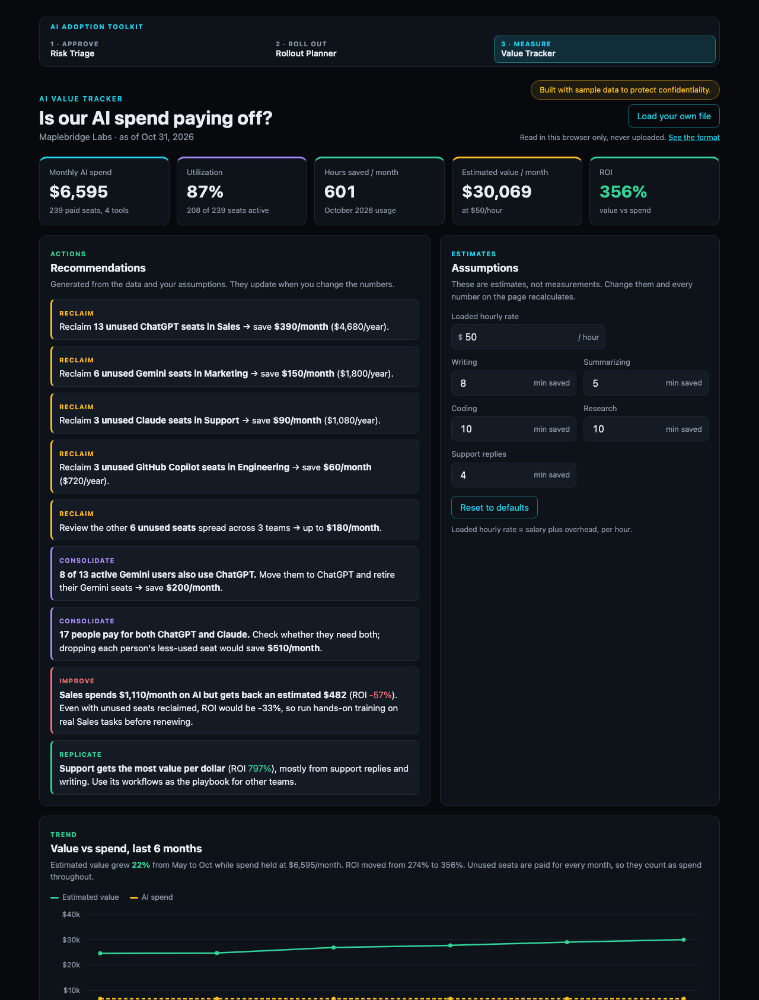

# AI Value Tracker

> Built with sample data to protect confidentiality. "Maplebridge Labs" is a fictional company.

## Problem
Companies are paying for AI tools like Claude, ChatGPT and Copilot, but most can't tell whether the spend is worth it. When leadership asks "is our AI investment paying off?", IT usually can't answer with numbers.

## What this tool measures
- **Utilization:** how many paid AI seats are actually used
- **Waste:** seats unused for 30+ days, and what reclaiming them would save
- **Time saved:** estimated hours saved per team, per tool
- **ROI:** estimated value of time saved vs what the licences cost
- **Trend:** how value and ROI moved month by month over the last six months

## Result
With the default assumptions ($50/hour, 4–10 minutes saved per task), the sample data shows:

- **$6,595/month** spent on 239 AI seats returns an estimated **$30,069/month** in time saved: a **356% ROI** overall.
- **31 seats unused for 30+ days**, costing **$870/month ($10,440/year)**. The biggest block is 13 unused ChatGPT seats in Sales.
- **Support gets about 20× more value per seat than Sales** ($269 vs $13 a month). Sales is the only team losing money (ROI −57%), and it stays negative even after reclaiming its unused seats, so the fix is training, not just cutting seats.
- **Trend:** estimated value grew 22% from May to October while spend stayed flat, so ROI climbed from 274% to 356% as people got used to the tools.
- **Overlap:** 8 of 13 active Gemini users also use ChatGPT. Consolidating them saves $200/month.

The data is synthetic; the method is real. Click **Load your own file** on the dashboard to swap in a usage export from your AI vendors' admin consoles, in the same format as [`data/sample-usage.json`](data/sample-usage.json), and it answers the same questions with real numbers. The file is read in your browser and never uploaded. If it has a problem, the page lists what to fix and leaves the current data in place.

## How it works
1. `scripts/generate-sample-data.js` creates six months of realistic usage data for a fictional 200-person company.
2. `index.html` reads that data and calculates utilization, hours saved and ROI in one place, so every panel shows consistent numbers. The trend chart runs the same calculation once per month.
3. The assumptions (hourly rate, minutes saved per task) are editable on the page, because they're estimates. Change them and every number updates.
4. Recommendations come from simple, readable rules (for example, "3+ unused seats of one tool in one team → reclaim them"), so anyone can check why the tool suggests an action.

## How to run it
1. Open the live demo (link below), or download/clone this repository.
2. To run it locally, start a small web server in the project folder with `python3 -m http.server`, then open http://localhost:8000. If you double-click `index.html` instead, the browser blocks it from reading the data file; the page then offers a button to choose `data/sample-usage.json` yourself.
3. Optional: regenerate the data with `node scripts/generate-sample-data.js`. It uses a fixed seed, so you get the same numbers every time.

Live demo: https://sr-tech-hub.github.io/ai-value-tracker/

## Why I built it
In my IT role at a ~200-person company I managed AI tool access and usage (Claude, OpenAI). I saw first-hand that teams were encouraged to use AI but nobody could show its value. This project is how I'd answer that question.

## Part of the AI Adoption Toolkit
Three small tools covering the life of an AI tool at a company, linked by a shared menu bar:
- **[AI Tool Risk Triage](https://sr-tech-hub.github.io/ai-tool-risk-triage/)** ([code](https://github.com/sr-tech-hub/ai-tool-risk-triage)): should we approve it?
- **[AI Rollout Planner](https://sr-tech-hub.github.io/ai-rollout-planner/)** ([code](https://github.com/sr-tech-hub/ai-rollout-planner)): how do we roll it out?
- **AI Value Tracker** (this one): is it paying off?

## Built with
HTML, CSS and JavaScript (single page, no build step, no libraries; charts are plain SVG), developed with Claude Code.
